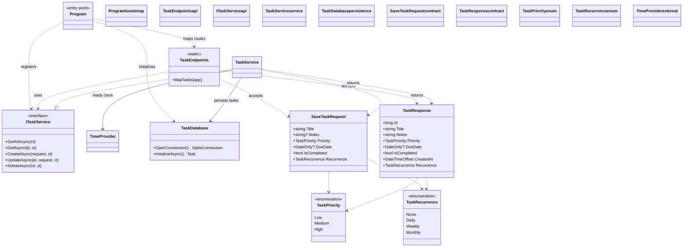

# Daybook Developer Guide

This guide covers running and testing Daybook, its implementation layout and
configuration, and the task API.

## Prerequisites

- .NET 10 SDK
- PowerShell or another terminal

## Run and test

From the repository root, start the app with:

```powershell
dotnet run --project .\src\TodoManager
```

The development launch profile listens at `http://localhost:5050`. Open that
address to use the browser UI. The app serves both the UI and the JSON API.

Run the integration tests with:

```powershell
dotnet test .\tests\TodoManager.Tests
```

The tests use temporary SQLite databases. They cover API CRUD and validation,
persistence, browser assets, OpenAPI, recurring tasks, and database upgrades.

## Project layout

- `Program.cs` configures dependency injection, JSON enum serialization,
  validation, OpenAPI, static files, and database initialization.
- `TaskEndpoints.cs` maps the HTTP routes under `/api/tasks`.
- `TaskContracts.cs` defines request and response models, priority and
  recurrence enums, and request validation attributes.
- `TaskService.cs` implements task CRUD and recurring-task generation.
- `TaskDatabase.cs` opens SQLite connections and creates or upgrades the schema.
- `wwwroot/` contains the browser UI assets.
- `TodoManager.http` contains example API requests.

## Class diagram



Colors distinguish application startup, API, service, persistence, contracts,
enums, and external dependencies, respectively.

## Configuration and persistence

By default, the SQLite database is stored at
`src/TodoManager/App_Data/tasks.db`. Override the location with the
`TaskDatabase__Path` environment variable or the `TaskDatabase:Path` setting.
Use an absolute path outside the public web root.

The schema is initialized automatically when the app starts. Existing databases
are upgraded in place, retaining task data. The application uses SQLite and is
designed for a single server; it does not provide multi-instance storage,
authentication, or real-time browser synchronization.

## Recurring tasks

Recurrence is applied when a task changes from incomplete to complete. The
completed task remains in history, and one incomplete successor is created in
the same database transaction. Its due date is calculated from the completion
date in the server's local timezone: one day, seven days, or one calendar month
later for daily, weekly, or monthly recurrence. A monthly date is clamped to the
last valid day of the target month. The previous due date does not affect the
successor's due date, and an initial due date is optional.

Each task occurrence can generate at most one successor, including if it is
reopened and completed again. Successors are not generated in the background;
deleting a task does not delete its successor. Set recurrence to `None` to stop
repeating from the active occurrence.

## API reference

The API is rooted at `/api/tasks`. Requests and responses use JSON with
camel-cased property names. Priority and recurrence values are strings, not
numbers. All successful task responses have this shape:

```json
{
  "id": 1,
  "title": "Plan the week",
  "notes": "Choose three priorities",
  "priority": "Medium",
  "dueDate": "2026-11-16",
  "isCompleted": false,
  "createdAt": "2026-11-10T20:00:00.0000000+00:00",
  "recurrence": "None"
}
```

`dueDate` is either a `YYYY-MM-DD` calendar date or `null`. `createdAt` is the
creation timestamp in UTC. The response's `notes` value is a string; omitted
notes in a request are stored as an empty string.

### Endpoints

| Method | Route | Success response | Description |
|---|---|---|---|
| `GET` | `/api/tasks` | `200 OK`, array of tasks | Lists tasks newest ID first. |
| `GET` | `/api/tasks/{id}` | `200 OK`, task | Gets a task by ID. |
| `POST` | `/api/tasks` | `201 Created`, task and `Location` header | Creates a task. |
| `PUT` | `/api/tasks/{id}` | `200 OK`, updated task | Replaces the task's editable fields. |
| `DELETE` | `/api/tasks/{id}` | `204 No Content` | Permanently deletes a task. |

Unknown IDs return `404 Not Found` for `GET`, `PUT`, and `DELETE`.

### Create and replace request

`POST /api/tasks` and `PUT /api/tasks/{id}` accept the same request shape:

```json
{
  "title": "Plan the week",
  "notes": "Choose three priorities",
  "priority": "High",
  "dueDate": "2026-11-16",
  "isCompleted": false,
  "recurrence": "Weekly"
}
```

| Property | Type | Required | Default | Rules |
|---|---|---:|---|---|
| `title` | string | Yes | — | 1–200 characters; whitespace-only titles are invalid. Surrounding whitespace is trimmed when stored. |
| `notes` | string or `null` | No | `""` | Maximum 2,000 characters; surrounding whitespace is trimmed. |
| `priority` | string | No | `"Medium"` | One of `"Low"`, `"Medium"`, or `"High"`. |
| `dueDate` | string or `null` | No | `null` | Valid `YYYY-MM-DD` calendar date. |
| `isCompleted` | boolean | No | `false` | Whether the task is complete. |
| `recurrence` | string | No | `"None"` | One of `"None"`, `"Daily"`, `"Weekly"`, or `"Monthly"`. |

`PUT` replaces these fields rather than partially updating them. Send the full
desired state; omitted optional fields take their defaults. For example, an
omitted `isCompleted` resets completion to `false`, and an omitted `dueDate`
clears the due date.

### Status and validation errors

- Invalid JSON values or request fields return `400 Bad Request` with a Problem
  Details response (`application/problem+json`).
- Invalid enum names, numeric enum values, invalid dates, missing titles, and
  over-limit title or notes values are rejected.
- A request to a task ID that does not exist returns `404 Not Found`.

### Examples

List tasks:

```http
GET /api/tasks
```

Create a task:

```http
POST /api/tasks
Content-Type: application/json

{
  "title": "Weekly review",
  "priority": "Medium",
  "recurrence": "Weekly"
}
```

Complete a recurring task (replace `1` with the task ID). The response contains
the completed task; the successor is a separate task returned by a later list
or get request:

```http
PUT /api/tasks/1
Content-Type: application/json

{
  "title": "Weekly review",
  "priority": "Medium",
  "isCompleted": true,
  "recurrence": "Weekly"
}
```

### OpenAPI and request samples

In the Development environment, the OpenAPI document is available at
`http://localhost:5050/openapi/v1.json`. The project's ready-to-run HTTP
examples are in [`TodoManager.http`](../TodoManager.http).

## Deployment and security notes

The default development listener is localhost-only. There is no authentication:
anyone who can reach the app can view and change all tasks. Do not expose it to
the public internet. Before hosting it publicly, add authentication and HTTPS,
and review the deployment and database backup approach for your environment.
